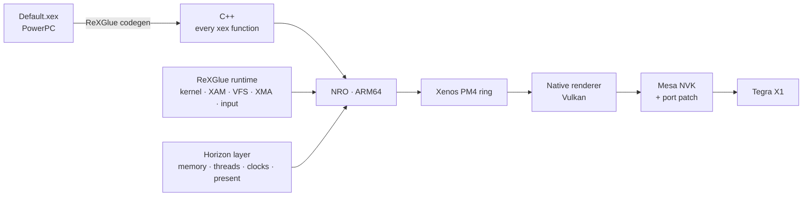

  

  

<h1 align="center">DARK SOULS II: Scholar of the First Sin — Nintendo Switch</h1>

  
  
  
  

An experimental Nintendo Switch port of the **Xbox 360** release (Title ID `465307E4`). It statically recompiles the game's PowerPC executable to ARM64 and renders through a purpose-built Vulkan backend on Mesa NVK. **This is neither an Xbox 360 emulator nor a port of the PC version.**

> [!NOTE]
> The [0.56 test build](https://github.com/XDASCATX/DS2_switch/releases/tag/v0.56) includes an NRO, its configuration and an optional HOME Menu forwarder. You need your **own Xbox 360 game files** and Compatibility Pack 4; none are distributed here. The repository is currently private, so the release is available only to people with access.

## Approach

The recompiled game still issues its original Direct3D/Xenos commands. A `GPU Commands` thread consumes the PM4 ring and translates its draw calls, resolves and swaps into Vulkan work. The ReXGlue runtime supplies the Xbox 360 environment; the Switch layer supplies its host memory, threads, audio, input and presentation. Full Xenos/EDRAM emulation remains in the binary as a configurable fallback.

| Layer | Implementation |
|---|---|
| **Recompilation** | ReXGlue codegen turns `Default.xex` into ~84,000 C++ functions. DS2-specific overrides recover missing entry points; a scanner fix handles 16-bit jump tables. |
| **Runtime** | ReXGlue SDK implements xboxkrnl, XAM, guest memory, virtual file system, XMA audio and input; DS2's `app/` adds paths, DLC installation, clocks and diagnostics. |
| **Graphics** | A native `GraphicsSystem`/`CommandProcessor` reads PM4 and records Vulkan commands. Render targets are host images; resolves become textures without an EDRAM round-trip. |
| **Shaders** | The SDK translates Xenos microcode to SPIR-V during play and caches translations by shader and modification. An offline shader library is **not** part of 0.56. |
| **Platform** | devkitA64 + libnx produce a single NRO; patched Mesa NVK translates Vulkan to Tegra X1 commands. |

## Engineering highlights

### From executable to game world

- **Codegen correctness:** manually classified missing function entries, added data/code-pointer overrides and recovered 370 genuine gaps missed by the scanner. Fixing its 16-bit jump-table decoding restored the character-creation script without a gameplay bypass.
- **Switch memory:** aligned guest-memory mappings and commits to 2 MiB boundaries, reduced host-thread stacks and configured nvservices memory. This removed the resource failures that blocked level loading under hbloader.
- **Integration:** game-file and DLC paths, saves, system keyboard, controller input, XMA audio, cutscenes and per-session clock control sit on top of the ReXGlue/NFSMW-NX Switch foundation.

### Native renderer

| Mechanism | Why it exists |
|---|---|
| **MSAA in sample space** | A 4× 640×360 target is represented as a 1280×720 image, allowing DS2's 1× and 4× views of the same EDRAM region to share storage. It preserves the game's reinterpretation trick, at the cost of extra shading. |
| **Native resolves** | Image copies produce textures the next passes can sample directly; depth and two DS2-specific color reinterpretations have explicit conversion paths. |
| **GPU-side work reduction** | Conditional early depth testing, one submission per frame and barriers around copies/uploads rather than every render pass. |
| **CPU-side work reduction** | Dynamic UBO offsets, descriptor-set reuse within a frame, faster register writes and texture untiling, and cached sub-resolve lookups. |
| **Pipelines and lifetime** | New pipelines compile on a worker thread; frame slots defer destruction until GPU work finishes. Unused textures and resolve targets are evicted by age. |

The [Mesa NVK patch](tools/switch/toolchain/mesa-switch-ds2-perf.patch) adds direct CPU-side UBO descriptor handling on Maxwell, sparse-buffer support and NAK compiler tuning. An earlier EDRAM-emulation renderer is kept as a fallback; ongoing development targets the native path. Implementation details and limitations: [native-renderer reference](docs/reference/native-renderer.md) · [performance measurements](docs/performance.md) · [known issues](docs/known-issues.md).

## Toolchain & observability

| Component | Role |
|---|---|
| **ReXGlue codegen + C++23** | Static PowerPC recompilation, configured by manifests and address overrides in `app/` and `config/`. |
| **devkitA64, libnx, CMake & Ninja** | ARM64 compilation, Horizon integration and NRO packaging. |
| **Mesa NVK, NAK & SPIR-V translator** | Vulkan driver, Maxwell shader compilation and runtime translation of Xenos shaders. |
| **FFmpeg** | Decoding the game's XMA audio and WMV cutscenes through the SDK. |
| **Profiling tools** | Per-thread CPU samples, GPU timestamps corrected for the Switch clock, per-pass/draw timing, hitch logs and optional L3+R3 frame captures. |

[XenosRecomp](https://github.com/hedge-dev/XenosRecomp) and DXC were **evaluated** for a future offline shader library; they are not required by the current rendering pipeline. For reproducible builds and diagnostics, see [build instructions](docs/build.md), [project architecture](docs/architecture.md) and the [documentation index](docs/README.md). Building from source requires a personally supplied copy of the Xbox 360 game; generated game code and release binaries are not tracked in Git.

## Release & repository

The [0.56 release](https://github.com/XDASCATX/DS2_switch/releases/tag/v0.56) contains `ds2.nro` and `ds2.toml`, plus an optional NSP that points to `sdmc:/switch/ds2/ds2.nro` (it contains neither the NRO nor game files). The game expects its own files under `sdmc:/switch/ds2/game_root/`; [release notes](RELEASE_0.56.md) describe the required layout. The forwarder is unsigned homebrew and its launch has not been verified on a physical Switch.

> [!WARNING]
> The supplied v56/0.56 configuration requests **CPU 1963 MHz / GPU 1267 MHz**, leaves the memory clock unchanged and enables detailed logs. These are non-stock clocks and require a suitable clock sysmodule and hardware. A crash may leave the override active until it is cleared or the console is restarted. Stable 30 FPS everywhere is a development goal, not a release claim.

| Path | Contents |
|---|---|
| `app/` | DS2 integration, codegen manifest and host/Switch app. |
| `sdk/` | ReXGlue SDK, Switch platform and native Vulkan renderer. |
| `config/` | Codegen overrides and versioned `ds2.toml` history. |
| `tools/` | Build, packaging, console-log analysis and shader research. |
| `docs/` | Architecture, testing history, performance data and code references. |

## Credits & legal

Maintained by **xDASCATx**. Built on [ReXGlue](https://github.com/rexglue/rexglue-sdk) and [Xenia](https://xenia.jp), the [NFSMW-NX](https://github.com/StevensND/nfsmw-nx) Switch work, [mesa-switch](https://github.com/danfromtico/mesa-switch), [devkitPro](https://devkitpro.org) and [libnx](https://github.com/switchbrew/libnx). The optional forwarder uses an [NTON](https://github.com/rlaphoenix/nton) loader. See [third-party notices](THIRD_PARTY_NOTICES.md) and [license](LICENSE).

Unofficial fan project; not affiliated with or endorsed by FromSoftware, Bandai Namco, Microsoft or Nintendo. DARK SOULS and the promotional art belong to their respective owners. No game files, generated game code or console keys are committed to this repository.
