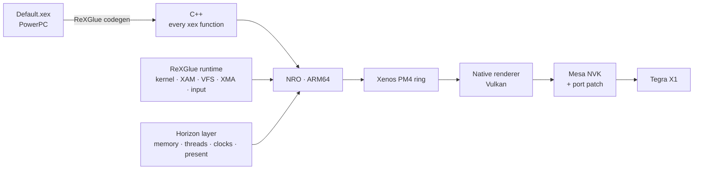

<p align="center">
  
</p>

<p align="center">
  
</p>

<h1 align="center">DARK SOULS II: Scholar of the First Sin — Nintendo Switch</h1>

<p align="center">
  
  
  
  
</p>

An experimental Nintendo Switch port of the **Xbox 360** release (Title ID `465307E4`). The game's PowerPC executable is
statically recompiled to ARM64 C++ and rendered by a purpose-built Vulkan renderer on Mesa NVK. **This is neither an
Xbox 360 emulator nor a port of the PC version.**

> [!NOTE]
> You need your **own Xbox 360 game files** and Compatibility Pack 4. No game files, generated game code or keys are
> distributed here.

## Status (build v104)

- Playable: tested from the new-game intro through Majula, the bosses so far and into the first DLC area.
  Russian or English interface (other disc languages through the emulated region).
- Around **31–40 FPS** (typically ~33) in heavy scenes with the clocks of the supplied configuration
  (CPU 1963 / GPU 1267 / memory 2500 MHz); about **17–29 FPS** at stock clocks. The limits now are the GPU
  (25–32 ms per frame) and the renderer's command thread (~20 ms).
- Intro videos, saves, DLC, audio, achievements and the controller work.

## How it works



The recompiled game still issues its original Xenos (Direct3D 9) commands. A `GPU Commands` thread reads the PM4 ring
and turns its draws, resolves and swaps into Vulkan work, without emulating EDRAM. The ReXGlue runtime provides the
Xbox 360 kernel and XAM; the Switch layer provides memory, threads, audio, input, clocks and presentation.

## Engineering highlights

### Recompiled game code

- **Optimised code generation:** PowerPC registers r14–r31, f14–f31, cr, ctr and xer are C++ locals instead of fields
  of an in-memory context; calls between game functions are direct and can be inlined; guest memory is accessed
  without `volatile`, with compiler barriers on every loop back-edge and on `sync`/`lwsync`/`eieio`. About +25% FPS
  where the CPU is the limit.
- **Correctness of that generation:** function pieces and exception funclets that read their owner's registers are
  marked `share_registers` (only real pieces, checked by prologue analysis); vector registers stay in the context
  because the Bink video decoder passes values between its hand-written VMX functions in them;
  `-fno-strict-aliasing` for the generated code.
- **Discovery:** data-only and code-pointer entry points, recovered gaps and a missing vtable thunk; a scanner fix for
  16-bit jump tables.

### Native renderer

| Mechanism | What it does |
|---|---|
| **Offline shader library** | 1,444 shaders, 35,000+ SPIR-V variants, spirv-opt optimised and indexed; restored on a worker thread, pipelines compiled asynchronously. |
| **Texture signs in the pipeline** | Signed/unsigned/gamma texture components are specialization constants, so the driver removes the per-fetch branches: main passes 20–50% faster on the GPU. |
| **Reduced-resolution particles** | Fog and smoke drawn at half resolution and composited (with a reduced depth buffer for opaque fog); single draws that cost up to 64 ms. |
| **Textures** | 1D, cube and 3D (volume) textures, fast untiling, dynamic textures for videos. |
| **Depth and lighting** | Xenos absolute depth bias through `VK_EXT_depth_bias_control`, float24 depth, correct D24FS8 scale (bonfire light no longer leaks through walls). |
| **Host 4x MSAA** | Hardware MSAA only where the game really renders 4x, instead of sample-space emulation. |
| **CPU side** | Redundant state filtering (~74% of state calls skipped), persistent descriptor sets, constant buffer reuse, per-thread MSR. |

The [Mesa NVK patch](tools/switch/toolchain/mesa-switch-ds2-perf.patch) adds direct UBO handling on Maxwell, a sparse
guest-memory buffer and NAK compiler tuning.

### Platform

- First boot unpacks the DLC and save packages with an on-screen progress bar.
- File system errors on unusual SD cards are logged instead of ending the game.
- Clocks are set from the configuration (needs a clock sysmodule); Russian and other EU languages through the
  emulated game region.
- Built-in diagnostics: GPU profiler per pass and per draw, CPU sampling profiler, crash reports with the guest stack,
  frame captures (L3+R3).

## Installation

```text
sdmc:/switch/ds2/
  ds2.nro
  ds2.toml
  ds2_shaders_v104.spvlib        # shader library (name set in ds2.toml)
  ds2_shaders_v104.spvlib.idx
  game_root/Default.xex          # your Xbox 360 game files, original structure
  game_root/GameData1.bdt, GameData1.bhd, GameData2.bdt, GameData2.bhd, ...
  dlc/<Compatibility Pack 4 STFS file>   # unpacked on first launch
  user/                          # created by the port: saves and installed DLC
  logs/                          # created by the port

install DARK SOULS II Scholar of the First Sin (port) [0100D52000560000][v0].nsp - using DBI, as usual.
```
 
An NSP forwarder can start `ds2.nro` from the home menu.

**Port menus:** hold **L + R + Plus**, then press a D-pad direction: Up = debug overlay, Right = settings,
Down = log console, Left = achievements.

> [!WARNING]
> The supplied configuration requests non-stock clocks (CPU 1963 MHz, GPU 1267 MHz, RAM 2500 MHz). They only apply
> with a suitable clock sysmodule and hardware. Lower them in `ds2.toml` (`ds2_switch_cpu_mhz`, `ds2_switch_gpu_mhz`,
> `ds2_switch_mem_mhz`; 0 = leave unchanged) to play at stock clocks.

## Repository

| Path | Contents |
|---|---|
| `app/` | DS2 app: codegen manifests, DLC installation, input scripts, watchdog, overlays. |
| `sdk/` | ReXGlue SDK with the Switch platform and the native Vulkan renderer. |
| `config/` | Code generation overrides (entry points, gaps, `share_registers`). |
| `tools/` | Toolchain, build, code generation, shader library and analysis tools ([tools/README.md](tools/README.md)). |

Building needs a personally supplied copy of the Xbox 360 game; generated game code and binaries are not tracked.

## Credits & legal

Maintained by **xDASCATx**. Built on [ReXGlue](https://github.com/rexglue/rexglue-sdk) and [Xenia](https://xenia.jp),
the [NFSMW-NX](https://github.com/StevensND/nfsmw-nx) Switch work, [mesa-switch](https://github.com/danfromtico/mesa-switch),
[devkitPro](https://devkitpro.org) and [libnx](https://github.com/switchbrew/libnx). The optional forwarder uses an
[NTON](https://github.com/rlaphoenix/nton) loader. See [third-party notices](THIRD_PARTY_NOTICES.md) and
[license](LICENSE).

Unofficial fan project; not affiliated with or endorsed by FromSoftware, Bandai Namco, Microsoft or Nintendo.
DARK SOULS and the promotional art belong to their respective owners.
