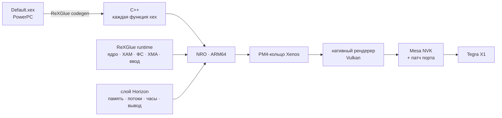

<p align="center">
  
</p>

<p align="center">
  
</p>

<h1 align="center">DARK SOULS II: Scholar of the First Sin — Nintendo Switch</h1>

<p align="center">
  
  
  
  
</p>

Нативный порт Xbox 360-версии (title ID `465307E4`) на Nintendo Switch. Не эмулятор: весь PowerPC-код
`Default.xex` переведён в C++ и собран под ARM64, кадр рисует собственный Vulkan-рендерер.

> [!NOTE]
> Нужна своя копия игры для Xbox 360. Репозиторий не содержит ни ресурсов, ни кода игры.

## Подход



| Слой | Механизм |
|---|---|
| **Рекомпиляция** | ReXGlue переводит каждую функцию xex в C++; границы функций, таблицы переходов и пропущенные участки дополняются overrides (`config/`) и собственными инструментами анализа |
| **Рантайм** | ядро Xbox 360, XAM, файловая система, XMA-аудио и ввод — из ReXGlue; поверх — слой Horizon: отображение гостевой памяти, потоки, исключения, часы, презентация |
| **Рендерер** | читает PM4-кольцо игры и записывает Vulkan напрямую; render target'ы — родные изображения, resolve — родные текстуры, EDRAM не эмулируется |
| **Шейдеры** | микрокод Xenos → SPIR-V, кеш модулей по хэшу микрокода |
| **Драйвер** | Mesa NVK для Horizon с патчем под нагрузку игры |
| **Эталон** | эмуляция GPU Xenos остаётся в том же бинарнике: A/B-сверка кадра одним параметром TOML |

## Механизмы рендерера

| Механизм | Что даёт |
|---|---|
| MSAA в пространстве сэмплов | 1x- и 4x-виды одной области EDRAM — одно изображение, без переносов |
| Resolve в нативную текстуру | выборка без записи в память игры и повторной загрузки |
| Early-Z для шейдеров без kill / depth-out | скрытые фрагменты не затеняются |
| Барьеры только на копиях и загрузках | без простоев GPU между проходами |
| Одна отправка в GPU на кадр | минимум накладных расходов NVK |
| Асинхронная сборка конвейеров | без зависаний кадра на новых материалах |
| Вытеснение ресурсов по сроку | текстуры, view'ы и framebuffer'ы освобождаются без нехватки памяти |

Патч Mesa NVK: UBO напрямую (без ожиданий GPFIFO), sparse-буфер под гостевую память, вытеснение render target'ов
при нехватке памяти, настройка компилятора NAK под Switch.

## Успехи

| | |
|---|---|
| 🗡️ **Игра проходится** | вступление → редактор персонажа → Маджула → Лес павших гигантов |
| ⚡ **Нативный рендерер ×2** | **25–30 FPS** в Маджуле против 11–16 на эмуляции Xenos |
| 🎨 **Точнее эмуляции** | корректные цвета, освещение, небо и HUD |
| 🧩 **Полный код игры** | восстановлено **370** функций, пропущенных генератором; исправлен разбор 16-битных таблиц переходов |
| 🔧 **0 ожиданий GPFIFO** | за счёт собственного патча NVK |
| ⌨️ **Интеграция с Horizon** | системная клавиатура, сохранения, частоты CPU/GPU выставляет сама игра |

## Инструменты

| Инструмент | Назначение |
|---|---|
| Меню **L + R + →** | все параметры рендера и диагностики на лету |
| Снимок кадра **L3 + R3** | трасса draw-вызовов и изображения всех целей кадра на SD |
| Профиль GPU | время по проходам с поправкой таймера Switch (614,4 МГц), журнал рывков |
| Watchdog | сэмплирование стеков потоков, отчёт о зависаниях с символизацией по ELF |
| `tools/analysis/` | разбор логов консоли: время кадра, дампы resolve → PNG, параметры, «дыры» codegen |
| `tools/*.py` | трассировка и поиск пропущенных функций для codegen |
| `tools/run/run-pc.sh` | та же игра на PC для проверки кадра до консоли |
| `ds2.toml` | воспроизводимые эксперименты: один параметр — один замер |
| `audit/` | сверка копии игры по хэшам, без самих файлов |

## Сборка

devkitA64 + libnx, CMake, Ninja, Python, [mesa-switch](https://github.com/danfromtico/mesa-switch) + патч порта.

```sh
. tools/build/env.sh
tools/build/build-mesa.sh <sdk>     # при изменении Mesa
tools/build/build-switch.sh         # → out/app-switch/ds2.nro
```

| Путь | |
|---|---|
| `app/` | приложение, платформа Switch, профайлер, захват кадров |
| `sdk/` | ReXGlue SDK с правками порта, нативный рендерер |
| `config/` | overrides для codegen |
| `tools/` | сборка, анализ, патч Mesa |
| `docs/` | [`HANDOFF.md`](https://github.com/XDASCATX/DS2_switch/blob/diag/switch-level-load/docs/HANDOFF.md) · [рендерер](https://github.com/XDASCATX/DS2_switch/blob/diag/switch-level-load/docs/handoff/18-native-renderer.md) · [оптимизация](https://github.com/XDASCATX/DS2_switch/blob/diag/switch-level-load/docs/handoff/16-switch-gpu-optimization.md) |

## Благодарности

[ReXGlue SDK](https://github.com/rexglue/rexglue-sdk) ([Xenia](https://xenia.jp)) ·
[nfsmw-nx](https://github.com/StevensND/nfsmw-nx) ·
[mesa-switch](https://github.com/danfromtico/mesa-switch) ·
[XenosRecomp](https://github.com/hedge-dev/XenosRecomp) ·
[devkitPro](https://devkitpro.org) · [libnx](https://github.com/switchbrew/libnx)

## Правовая информация

Неофициальный фан-проект, не связан с FromSoftware, Bandai Namco, Microsoft и Nintendo. DARK SOULS —
товарный знак владельцев; изображения — официальные промо-материалы. Homebrew требует кастомной прошивки,
что нарушает условия Nintendo.
