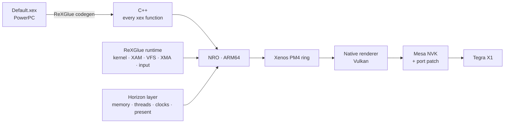

<p align="center">
  
</p>

<p align="center">
  
</p>

<h1 align="center">DARK SOULS II: Scholar of the First Sin — Nintendo Switch</h1>

<p align="center">
  
  
  
  
</p>

A native Nintendo Switch port of the Xbox 360 version (title ID `465307E4`). Not an emulator: every PowerPC
function of `Default.xex` is translated to C++ and compiled for ARM64, and frames are drawn by a custom Vulkan
renderer.

> [!NOTE]
> You need your own copy of the Xbox 360 game. This repository contains no game assets or game code.

## Approach



| Layer | Mechanism |
|---|---|
| **Recompilation** | ReXGlue translates every xex function to C++; function boundaries, jump tables and missed code are completed with overrides (`config/`) and custom analysis tools |
| **Runtime** | Xbox 360 kernel, XAM, file system, XMA audio and input from ReXGlue, on top of a Horizon layer: guest memory mapping, threads, exceptions, clocks, presentation |
| **Renderer** | Consumes the game's PM4 ring and records Vulkan directly; render targets are native images, resolves are native textures, no EDRAM emulation |
| **Shaders** | Xenos microcode → SPIR-V, modules cached by microcode hash |
| **Driver** | Mesa NVK on Horizon with a patch tuned for the game's workload |
| **Reference** | Full Xenos GPU emulation stays in the same binary: one TOML switch for A/B frame validation |

## Renderer mechanisms

| Mechanism | Effect |
|---|---|
| MSAA in sample space | 1x and 4x views of the same EDRAM region are one image, no transfers |
| Resolve to native texture | sampled directly, no write-back to guest memory or re-upload |
| Early-Z for shaders without kill / depth-out | occluded fragments are never shaded |
| Barriers only on copies and uploads | no GPU idle between passes |
| Single GPU submit per frame | minimal NVK submission overhead |
| Async pipeline compilation | no frame stalls on new materials |
| Age-based resource eviction | textures, views and framebuffers freed before memory runs out |

Mesa NVK patch: direct UBOs (no GPFIFO waits), sparse buffer for guest memory, render-target eviction under memory
pressure, NAK compiler tuning for Switch.

## Results

| | |
|---|---|
| 🗡️ **Playable** | intro → character creation → Majula → Forest of Fallen Giants |
| ⚡ **2× from the native renderer** | **25–30 FPS** in Majula vs 11–16 under Xenos emulation |
| 🎨 **More accurate than emulation** | correct colors, lighting, sky and HUD |
| 🧩 **Complete game code** | **370** functions missed by the code generator recovered; 16-bit jump table decoding fixed |
| 🔧 **Zero GPFIFO waits** | via the custom NVK patch |
| ⌨️ **Horizon integration** | system keyboard, saves, CPU/GPU clocks set by the game itself |

## Tooling

| Tool | Purpose |
|---|---|
| **L + R + →** menu | every renderer and diagnostics setting, live |
| **L3 + R3** frame capture | draw-call trace and every render target of the frame dumped to SD |
| GPU profiler | per-pass timings with corrected Switch timer (614.4 MHz), hitch log |
| Watchdog | thread stack sampling, stall reports symbolized against the ELF |
| `tools/analysis/` | console log analysis: frame time, resolve dumps → PNG, settings, codegen gaps |
| `tools/*.py` | tracing and missed-function discovery for codegen |
| `tools/run/run-pc.sh` | the same game on PC to validate frames before hardware |
| `ds2.toml` | reproducible experiments: one parameter, one measurement |
| `audit/` | game copy verification by hashes, no game files |

## Build

devkitA64 + libnx, CMake, Ninja, Python, [mesa-switch](https://github.com/danfromtico/mesa-switch) + the port's patch.

```sh
. tools/build/env.sh
tools/build/build-mesa.sh <sdk>     # only when Mesa changes
tools/build/build-switch.sh         # → out/app-switch/ds2.nro
```

| Path | |
|---|---|
| `app/` | application, Switch platform, profiler, frame capture |
| `sdk/` | ReXGlue SDK with port changes, native renderer |
| `config/` | codegen overrides |
| `tools/` | build, analysis, Mesa patch |
| `docs/` | technical documentation |

## Credits

[ReXGlue SDK](https://github.com/rexglue/rexglue-sdk) ([Xenia](https://xenia.jp)) ·
[nfsmw-nx](https://github.com/StevensND/nfsmw-nx) ·
[mesa-switch](https://github.com/danfromtico/mesa-switch) ·
[XenosRecomp](https://github.com/hedge-dev/XenosRecomp) ·
[devkitPro](https://devkitpro.org) · [libnx](https://github.com/switchbrew/libnx)

## Legal

Unofficial fan project, not affiliated with FromSoftware, Bandai Namco, Microsoft or Nintendo. DARK SOULS is a
trademark of its owners; images are official promotional art. Running homebrew requires custom firmware, which
violates Nintendo's terms of service.
